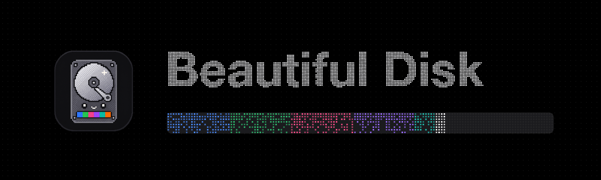
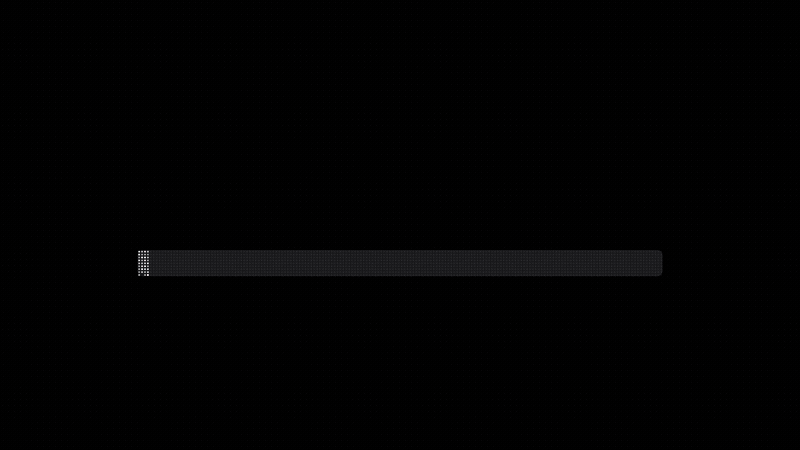

<p align="center">
  
</p>

<p align="center">See what fills your Mac, then clear what your tools left behind.</p>

<p align="center">
  <a href="https://github.com/vkpdeveloper/beautifuldisk/releases/latest/download/beautiful-disk-launch.mp4">
    
  </a>
  <br>
  <sub>Click for the video with sound.</sub>
</p>

## What it does

- Scans your disk in seconds and shows it as one dithered bar: apps, developer files, photos, movies, documents, music, caches, trash and system data.
- Finds clutter that is safe to clear and lays it out as a treemap, sized by bytes:
  - `node_modules`, Rust build output, Xcode build data, archives and device support
  - iOS simulators and Android emulators (running ones are kept)
  - Agent worktrees from T3 Code, Codex, Cursor and Conductor (only ones without changes)
  - Package caches: Gradle, Yarn, Go, Cargo, Homebrew, CocoaPods, Playwright
  - Browser caches, downloaded models (Hugging Face, Ollama, LM Studio), old installers and the Trash
- Clears everything you picked at the same time, with quiet ticks and a whoosh when it is gone.

## Install

Download `Beautiful-Disk.dmg` from the [latest release](https://github.com/vkpdeveloper/beautifuldisk/releases/latest) and drag the app to Applications.

The app is not notarized yet. On first launch, right-click it and choose Open, or run:

```sh
xattr -dr com.apple.quarantine "/Applications/Beautiful Disk.app"
```

Needs a Mac with Apple silicon.

## Build

```sh
cargo run --release            # run it
cargo run --release -- --demo  # sample data, deletes nothing
./bundle.sh --dmg              # Beautiful Disk.app and the DMG in target/release
```

The launch video is made with [Remotion](https://www.remotion.dev) in [`launch-video/`](launch-video), from a recording of the app in `--autoplay` mode.
